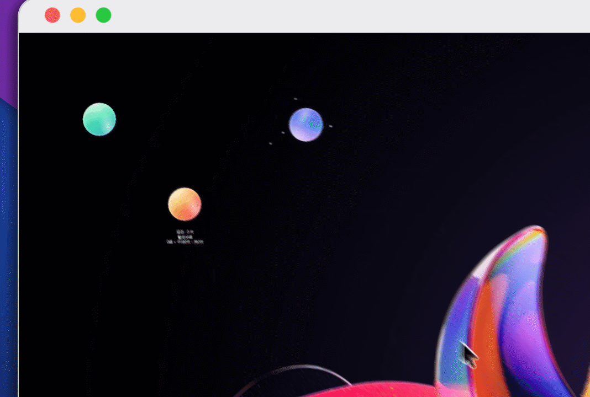
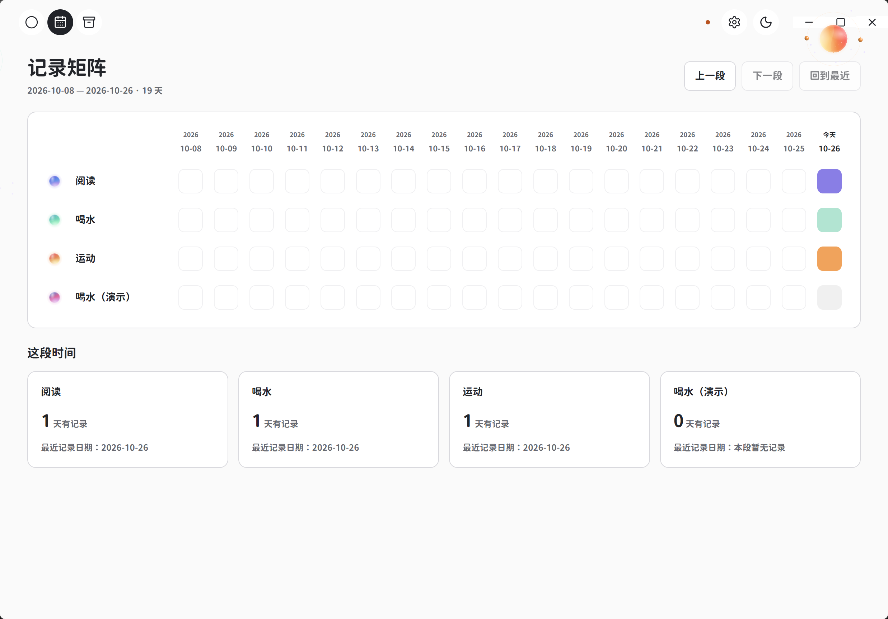

  

<h1 align="center">星以为常 habitOrbit</h1>

<strong>桌面上的星球计数器：做完一次，点一下。</strong>

简体中文 · <a href="README.en.md">English</a>

  <a href="#features">功能与演示</a> ·
  <a href="#start">下载与使用</a> ·
  <a href="#why">为什么做、相关研究</a> ·
  <a href="#credits">致谢、License</a>

  
  
  

---

我经常在电脑前一坐就是几个小时。水杯就在旁边，但做项目的时候一投入，就容易忘记喝水，也忘了起来活动。偶尔想起来喝了几杯，到了晚上又记不清具体喝了多少。如果每次都要打开软件、输入数字，又觉得没必要为这点小事打断手头的工作。

另一个启发来自我读到的一篇[2024 年的研究](https://doi.org/10.1111/sms.14628)。研究人员让18名超重或肥胖男性参加实验，发现久坐期间每隔45分钟进行3分钟步行或深蹲，相比一次连续步行30分钟，能带来更低的餐后血糖反应。这让我开始关注那些分散在一天中的短暂活动。哪怕只是离开椅子走几分钟，也值得认真对待。

于是我做了「星以为常」，希望让这些日常小事更容易被记起，也更方便记录。每件事都可以变成桌面上的一颗小星球，比如喝完一杯水，点一下星球，就会按提前设置好的容量记录下来；起来活动了一次，也可以随手点一下。星球的颜色和光效还能自己调整，让这些想坚持的小事一直留在眼前。

## ✨ 功能与演示

### 创建星球，设置记录参数与外观

先为一件小事创建星球，填写名称，再设置“点一下算多少”和记录单位。例如，把喝水设为每次 200 毫升。接着选择配色、调整光效，在旁边直接看预览，保存后就能使用。单位和每次记录量在创建后固定，外观可以随时再改。

### 点击桌面星球计数

例如，给深蹲设为“点一下 = 10 次”。做完一组，左键点击星球中心，今天就增加 10 次；点错了，右键撤销今天最新的一份。记录时不用切到管理窗口，拖动可以移动星球，外围装饰区域允许鼠标穿透。

次数、数量与手动申报的时长都可以记录。例如每次 10 次深蹲，或每次 5 分钟走动，按自己的实际活动设置。时长以分钟填写。

### 拖动卡片整理活动

管理窗口把活动列成卡片。你可以拖动排序、成组，把常用活动放到顶部取用栏；是否常用、是否显示在桌面上分别控制。

### 记录矩阵与历史统计

记录矩阵把多个活动按日期并排显示，可以查看哪些天有记录。打开单颗星球的详情，还可以调整今日数量、把一天中的多次活动分组，并通过年度热力图、最近 7、30 或 90 天的柱图回看记录。

### 本地保存与备份

数据保存在本机。关闭管理窗口后，桌面星球和后台记录服务继续运行；从托盘选择“完全退出”才结束整个记录器。再次打开时，记录、外观和布局会恢复。

在“设置与备份”中导出 `.pulse-backup`，可以保存记录与布局。恢复备份会替换当前资料，操作前程序会保留一份恢复前副本。归档活动可以收起暂时不做的事情，并保留它的历史。

## 🚀 下载与使用

适用于 **Windows 10 2004 或更新版本的 x64 系统**。安装版携带程序运行所需的依赖，日常使用无需 Node.js、Rust 或 .NET SDK。

1. **下载并安装。** 下载 [Windows x64 安装包](https://github.com/Lucian-D-W/habitOrbit/releases/download/v0.1.0/habitOrbit-Setup-x64.exe)，运行 `habitOrbit-Setup-x64.exe`，完成后从开始菜单打开“星以为常 habitOrbit”。
2. **创建第一颗星球。** 填写名称、单位和每次记录量，选择外观并保存。双击总览卡片，或点击卡片右上角的显示器按钮，即可显示桌面星球。
3. **完成一次，记录一次。** 左键点击桌面星球中心增加一份，右键撤销今天最新的一份。需要查看明细时，在管理端选中卡片，按 Enter 进入详情。
4. **给记录留一份备份。** 在“设置与备份”中导出 `.pulse-backup`，保存到自己的备份位置。准备退出时使用托盘“完全退出”。

完整操作、数据位置和备份说明见[使用说明](docs/user-guide.md)。开机启动默认关闭，可在设置中自行启用。开发者可查看[开发与构建说明](docs/development.md)。

## 💡 为什么做、相关研究

**参考文献**

**1. Enhanced muscle activity during interrupted sitting improves glycemic control in overweight and obese men**\
Gao、Li、Finni 与 Pesola，2024，*Scandinavian Journal of Medicine & Science in Sports*，34(4)，e14628。[期刊原文](https://doi.org/10.1111/sms.14628)。18 名超重或肥胖男性参加随机交叉试验；在一次久坐实验中，每隔 45 分钟进行 3 分钟步行或深蹲，与一次连续 30 分钟步行相比，餐后血糖反应更低。这项短期结果触发了我记录零散活动的想法。

**2. What influences the selection of contextual cues when starting a new routine behaviour? An exploratory study**\
Stawarz、Gardner、Cox 与 Blandford，2020，*BMC Psychology*，8，29。[期刊原文](https://doi.org/10.1186/s40359-020-0394-9)。研究通过 39 人持续三周的服用维生素任务与访谈，讨论人们怎样选择日常提示。减少费力、把物品放在手边和显眼处是常见做法；单一提示与模糊计划容易失效，长期可见的提示也可能逐渐不再引人注意。

**3.《原子习惯》与行为改变的四原则**\
James Clear，2018，*Atomic Habits*。[作者官网节选](https://jamesclear.com/three-steps-habit-change)。书中把提示、渴望、反应、奖赏转化为四个设计问题：怎样让行动显而易见、有吸引力、容易开始，并带来满足感。这套实践框架是我思考习惯工具时的一个参照。

**设计参考与应用**

我最在意的是做完之后愿不愿意记录。如果每组活动都要打开窗口、找条目、填数量，我自己就容易嫌麻烦。所以我把数量预先设好，把记录按钮做成留在桌面上的星球。外观也值得花心思：这是我每天会看见很多次的东西，我希望自己喜欢它。这些阅读给了我参照，具体做法则来自我想怎样使用这个计数器。

## 🙏 致谢、License

感谢 [metasidd/Orb](https://github.com/metasidd/Orb) 对星球外观、配色和动画参数组织的启发，以及 [AOSP Launcher3](https://android.googlesource.com/platform/packages/apps/Launcher3/+/refs/tags/android-11.0.0_r2/) 对拖动排序与成组交互的参照。Windows 桌面呈现使用 Win2D；管理界面使用 Tauri、React、dnd-kit、ECharts、react-activity-calendar 与 Lucide，记录由 .NET 和 SQLite 保存。具体归属与许可见[第三方声明](THIRD_PARTY_NOTICES.md)。

Copyright © 2026 **Lucian W. (lucian-d-w)**。habitOrbit 原创软件代码采用 **[GPL-3.0-only](LICENSE)**，适用范围见[版权与许可说明](COPYRIGHT.md)。第三方代码和素材保留各自许可及通知。
